# Informe final · Proyecto DataOps: cálculo de salario total

**Curso:** DE – DataOps (DMC Institute) · **Autor:** Junior Rojas Fernandez · **Fecha:** noviembre 2026

**Repositorio:** https://github.com/JuniorRF19/dataops-comisiones

## 1. Resumen del proyecto

Se implementó un flujo automatizado que calcula el **salario total** de cada empleado (`salario_total = mnt_salario + comisión`). El flujo:

1. Extrae la tabla `dmc.rrhh.empleado` desde PostgreSQL.
2. Procesa el CSV `ComisionEmpleados_V1_<AAAAMM>.csv`, alojado en Blob Storage.
3. Une ambas fuentes por `empleado_id`.
4. Publica la tabla consolidada en **Parquet** (más una copia en Excel) en el **Data Lake**, particionada por periodo.

El flujo se versiona en **Git/GitHub** y se despliega con **Jenkins** a tres ambientes, **DEV → QA → PRD**, con pruebas automáticas y una **aprobación automatizada** basada en quality gates.

### Decisiones de diseño

| Requisito | Implementación | Justificación |
|---|---|---|
| Pipeline ADF (o Python) | `app/pipeline.py` (pandas + pyarrow) | El enunciado permite Python. Es testeable con pytest y portable. |
| Blob Storage / Data Lake | Azurite (emulador oficial de Azure Storage) | Se usa el mismo SDK `azure-storage-blob`, sin costo de suscripción. El código no cambia al pasar a Azure real. |
| Repositorio Git | GitHub, con ramas `main` / `develop` y Conventional Commits | El enunciado permite "Azure DevOps / GitHub". |
| CI/CD | Jenkins en Docker, configurado como código (JCasC) | El enunciado permite "Azure DevOps / Jenkins". Es reproducible con `docker compose up`. |
| Plantillas ARM | `infra/arm` (ADLS Gen2 + contenedores + Data Factory), validadas en la CI | Dejan la infraestructura de Azure versionada y lista para desplegar por ambiente. |
| Aprobaciones automatizadas | Quality gate estricto en QA + smoke test del Parquet + rama `main` | PRD solo recibe código y datos que pasaron QA. |
| Secretos | `.env` (ignorado por Git) y credencial `pg-dmc` en Jenkins | Ninguna credencial queda en el repositorio. |

## 2. Arquitectura

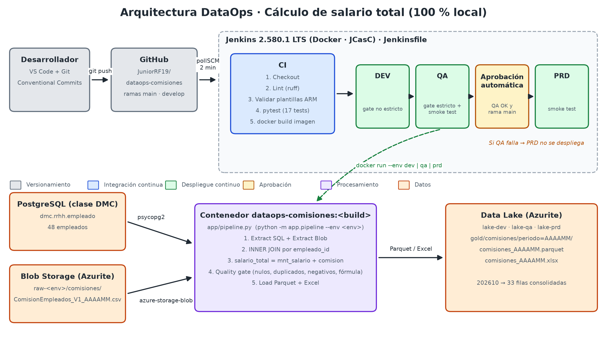

1. El desarrollador hace `git push` a GitHub.
2. Jenkins revisa el repositorio cada 2 minutos (pollSCM) y, si hay cambios, ejecuta el `Jenkinsfile`.
3. **CI:** lint, validación de las plantillas ARM, 17 unit tests y construcción de una imagen Docker inmutable.
4. **CD:** la misma imagen se ejecuta en DEV, QA y PRD (`docker run --env <env>`). Cada ejecución:
   - lee `rrhh.empleado` de PostgreSQL y el CSV de `raw-<env>`;
   - hace el JOIN y aplica el quality gate;
   - publica el Parquet y el Excel en `lake-<env>`.
5. **Aprobación automática:** PRD se ejecuta solo si QA pasó el quality gate estricto y el smoke test, y la rama es `main`.

## 3. Resultados del procesamiento (periodo 202610)

| Métrica | Valor |
|---|---|
| Filas leídas de `rrhh.empleado` | 48 |
| Filas leídas del CSV | 34 |
| Filas consolidadas (INNER JOIN) | **33** |
| ID del CSV descartado (no existe en BD) | 4 |
| Empleados de BD sin comisión en el periodo | 6, 7, 8, 38–48, 50 |
| Suma de `salario_total` | **436 905.20** |
| Salida | `lake-<env>/gold/comisiones/periodo=202610/comisiones_202610.parquet` (+ `.xlsx`) |

**Observación de calidad:** los nombres del CSV no coinciden con los de la BD (por ejemplo, el id 1 es "Juan Pérez" en el CSV y "Ana Pérez" en la BD). Como pide el enunciado, el cruce se hace solo por `empleado_id`. Se recomienda revisar este punto con el área de RR. HH.

## 4. Registro de pruebas

| # | Prueba | Tipo | Resultado esperado | Resultado obtenido | Evidencia |
|---|---|---|---|---|---|
| 1 | Lint del código (`ruff`) | CI | Sin errores | ✅ All checks passed | log de la etapa `CI · Lint, ARM y Unit tests` |
| 2 | Validación de plantillas ARM (dev/qa/prd) | CI | Parámetros válidos y nombres de Storage correctos | ✅ Plantillas ARM válidas | idem |
| 3 | Unit tests (`pytest`, 17 casos): normalización de columnas, encodings UTF-8/Latin-1, columnas faltantes, JOIN, fórmula, tipos Decimal, reglas de calidad | CI | 17/17 OK | ✅ 17 passed | `reports/junit.xml` y Test Result en Jenkins |
| 4 | Ejecución en DEV, periodo 202610 | CD | Parquet publicado en `lake-dev` | ✅ 33 filas | `evidencias/ejecucion_local_202610.log`, `logs/deploy_dev.log` |
| 5 | Ejecución en QA + smoke test | CD | Quality gate OK y Parquet legible | ✅ Verificación QA OK | `logs/deploy_qa.log` |
| 6 | Aprobación automática + ejecución en PRD | CD | PRD desplegado | ✅ Verificación PRD OK | `logs/deploy_prd.log`, `artifacts/prd/*.parquet` |
| 7 | Prueba negativa: CSV 209912 con comisión negativa, nula e id duplicado | Calidad | DEV avisa; QA falla; PRD no se ejecuta | ✅ DEV exit 0 con 4 errores reportados; QA exit 2 `QUALITY GATE FALLIDO` | `evidencias/prueba_negativa_quality_gate.log` |
| 8 | Pipeline completo desde GitHub (build #1 de `dataops-comisiones`) | CI/CD | CI + DEV → QA → PRD en verde | ✅ SUCCESS | `evidencias/jenkins_github_build_1_ok_202610.log`, capturas 05–08 |
| 9 | Prueba negativa en Jenkins desde GitHub (build #2, `PERIODO=209912`) | CI/CD | QA falla y PRD se omite | ✅ FAILURE en QA, PRD omitido | `evidencias/jenkins_github_build_2_fallo_qa_209912.log`, captura 09 |
| 10 | Disparo automático por `git push` (pollSCM, build #3) | CI/CD | Nuevo build sin intervención manual | ✅ "Started by an SCM change" | `evidencias/jenkins_github_build_3_push.log`, captura 10 |

## 5. Evidencias

La carpeta `evidencias/` contiene:

- `ejecucion_local_202610.log`: ejecución del pipeline en DEV, QA y PRD, más la verificación del Parquet de PRD.
- `prueba_negativa_quality_gate.log`: comportamiento del quality gate con datos inválidos.
- `jenkins_build_3_ok_202610.log` y `jenkins_build_4_fallo_qa_209912.log`: builds de validación previos a GitHub (job local de prueba).
- `jenkins_github_build_*.log`: consolas de los builds del job `dataops-comisiones` conectado a GitHub.
- `resultados/<env>/comisiones_202610.parquet|xlsx`: tablas consolidadas descargadas de los artefactos de Jenkins para DEV, QA y PRD.

### 5.1 Repositorio Git (GitHub)

**Figura 1.** Repositorio con el código, las plantillas ARM, el README y las evidencias.
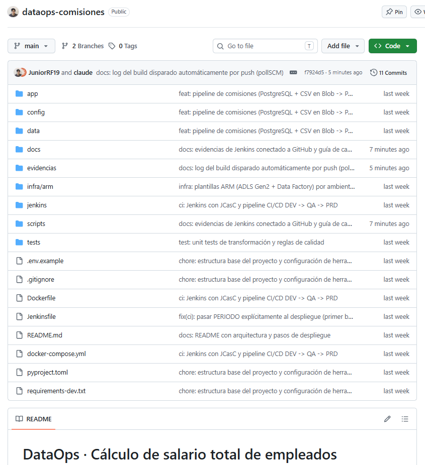

**Figura 2.** Historial de commits atómicos con Conventional Commits (`feat`, `test`, `infra`, `ci`, `fix`, `docs`).
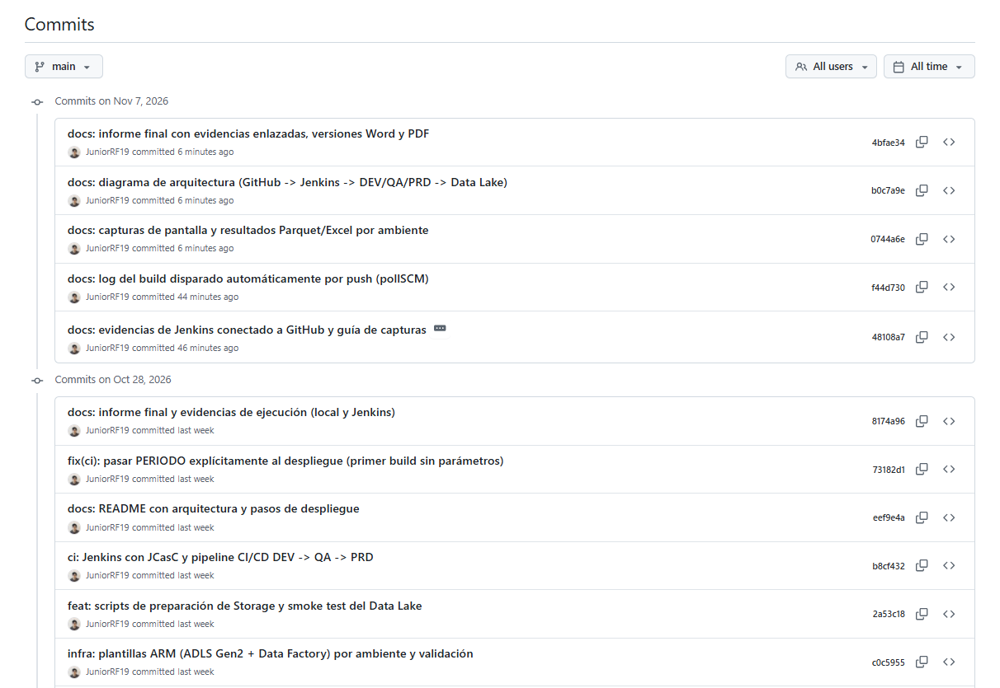

**Figura 3.** Ramas `main` (desplegable) y `develop` (integración).
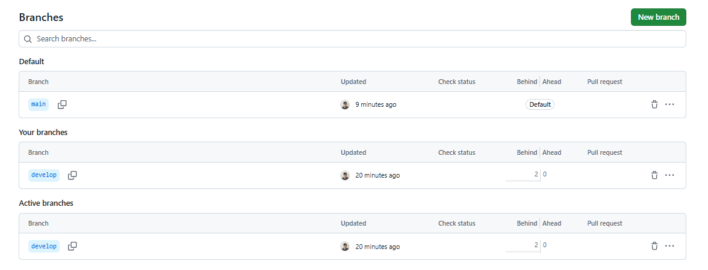

### 5.2 Pipeline CI/CD (Jenkins)

**Figura 4.** El job "Pipeline script from SCM" obtiene el `Jenkinsfile` desde GitHub.
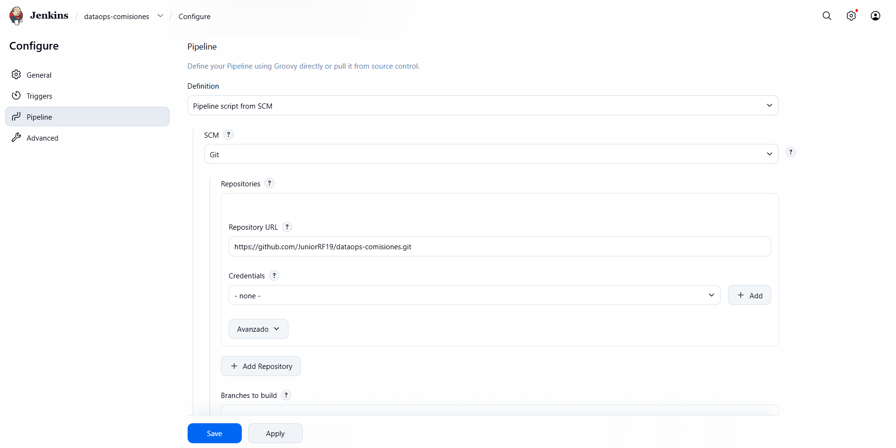

**Figura 5.** Stage View:
- los builds #1, #3 y #4 completan CI + DEV → QA → aprobación → PRD;
- el build #2 (datos inválidos) falla en QA y PRD no se despliega.

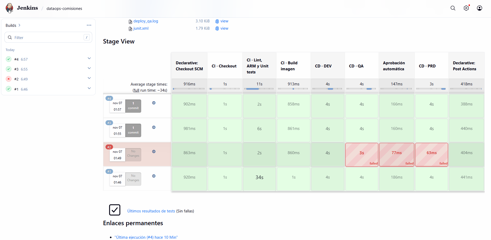

**Figura 6.** Resultado de los 17 unit tests publicados con JUnit.
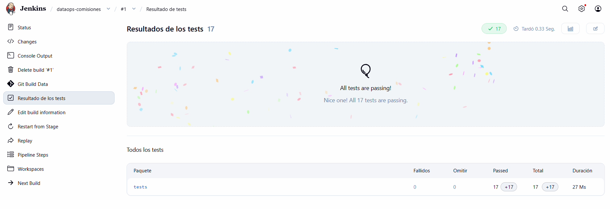

**Figura 7.** La consola del despliegue en PRD muestra "Verificación PRD OK" y "Finished: SUCCESS".
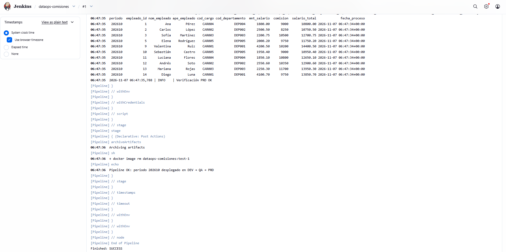

**Figura 8.** Artefactos del build: Parquet/Excel por ambiente, logs de despliegue y reporte de tests.
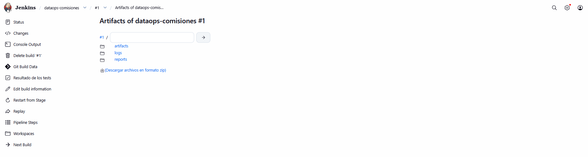

**Figura 9.** Quality gate de QA con `PERIODO=209912`: 4 reglas incumplidas, `QUALITY GATE FALLIDO` y las etapas de aprobación y PRD omitidas.
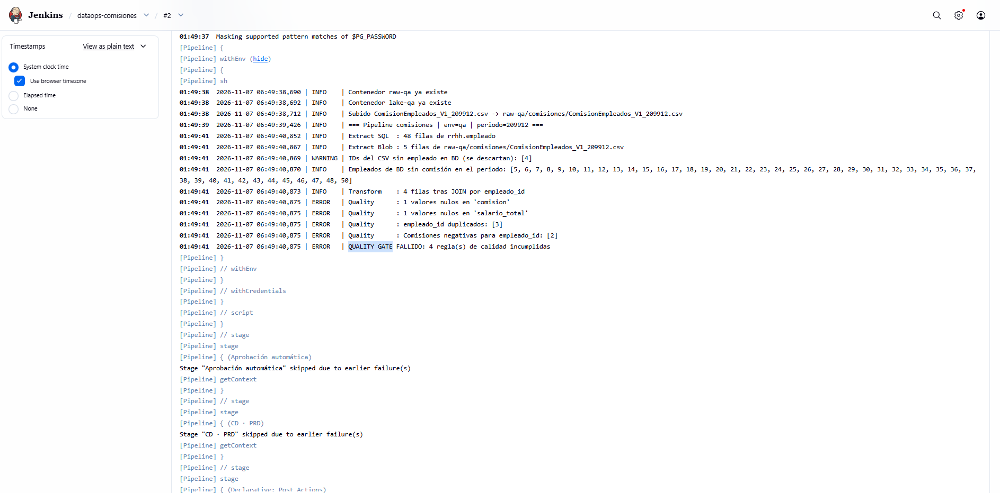

**Figura 10.** El build #3 se disparó automáticamente por un `git push` ("Started by an SCM change").
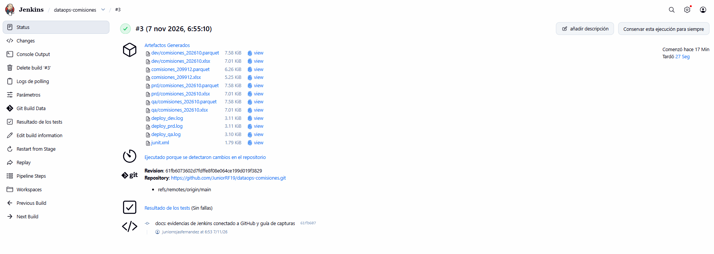

**Figura 11.** La credencial `pg-dmc` se guarda en Jenkins con la contraseña oculta; no está en el repositorio.
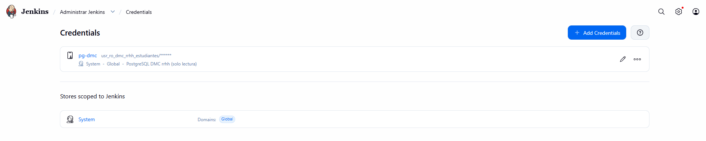

### 5.3 Datos y plataforma

**Figura 12.** Contenido del Storage: CSV en `raw-<env>` y Parquet/Excel en `lake-<env>`. Los datos inválidos de 209912 no llegaron a QA ni a PRD.
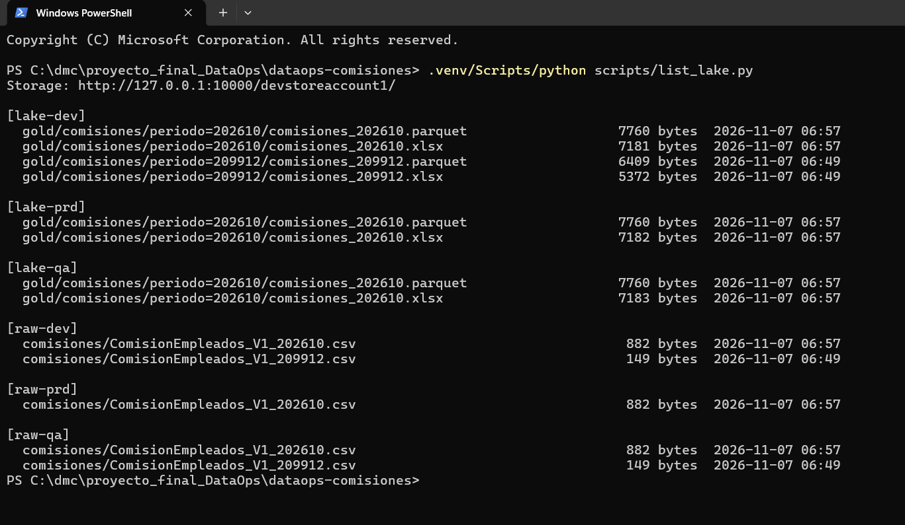

**Figura 13.** Tabla consolidada en PRD con `salario_total = mnt_salario + comision`.
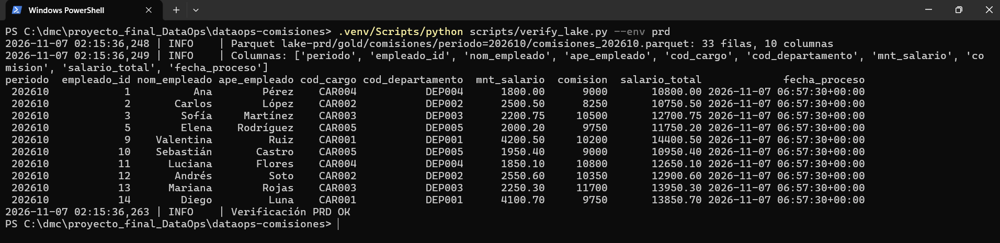

**Figura 14.** Contenedores de Azurite y Jenkins en ejecución.
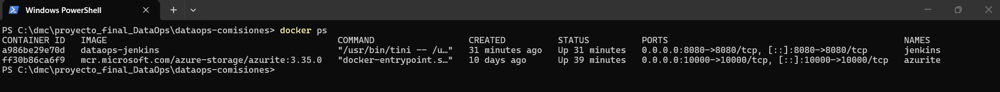
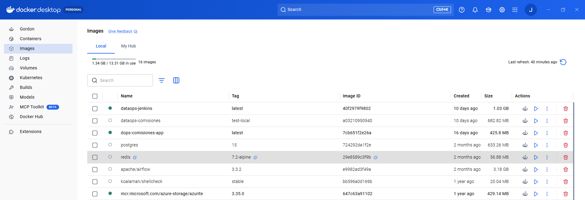

**Figura 15.** Unit tests ejecutados en local con pytest.
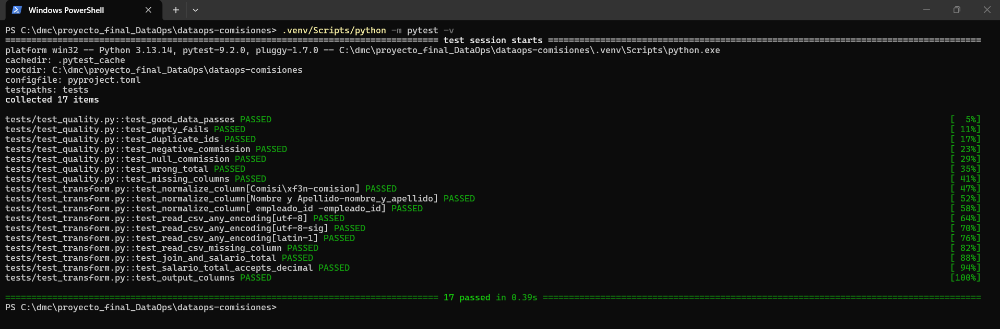

## 6. Conclusiones

- El flujo cumple el requerimiento funcional: extrae de PostgreSQL y de Blob, une por `empleado_id`, calcula `salario_total` y publica Parquet en el Data Lake.
- La CI garantiza calidad de código (lint), de la infraestructura (ARM) y de la lógica (unit tests) antes de construir la imagen.
- La CD promueve la misma imagen inmutable por DEV → QA → PRD. El quality gate de QA actúa como aprobación automatizada e impide que datos inválidos lleguen a producción.
- La solución corre 100 % en local. Para pasar a Azure basta con desplegar `infra/arm` y cambiar la cadena de conexión del Storage.
